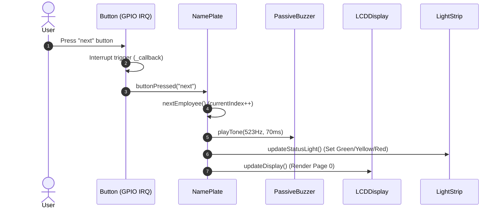
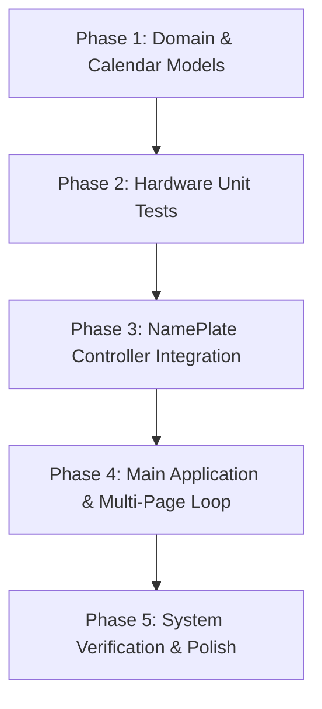

# Implementation Plan: Dynamic Office Nameplate System

**Platform:** MicroPython on Raspberry Pi Pico / Wokwi Simulator  
**Foundation:** UML Class Diagram (Finalized Draft) & PicoLibrary  
**Target File:** `implementation_plan.md`

---

## 1. System Architecture & Class Responsibilities

The system adheres strictly to the Model-View-Controller (MVC) and Object-Oriented design principles as captured in the finalized UML diagram. Concerns are decoupled across three main layers:

```
┌────────────────────────────────────────────────────────────────────────┐
│                        Controller Layer (NamePlate)                    │
│  - Event coordination (Button callbacks)                              │
│  - Pagination & LCD refresh scheduler                                  │
│  - Audio-visual feedback dispatch (Buzzer & LightStrip)               │
└──────────────────┬─────────────────────────────────┬───────────────────┘
                   │                                 │
                   ▼                                 ▼
┌─────────────────────────────────────┐  ┌───────────────────────────────┐
│          Domain Model Layer         │  │         Hardware Layer        │
│  - Employee (Abstract Base)         │  │  - Display / LCDDisplay       │
│  - Faculty, Staff, Administrator,   │  │  - Button                     │
│    StudentWorker                    │  │  - Light / LightStrip         │
│  - Calendar (Simulated event engine)│  │  - Buzzer / PassiveBuzzer     │
└─────────────────────────────────────┘  └───────────────────────────────┘
```

### 1.1 Domain Model Layer (Entities)

* **`Employee` (Abstract Base Class)**:
  * **Attributes:** `- name: str`, `- title: str`, `- department: str`, `- phone: str`, `- availability: str`.
  * **Responsibilities:** Holds shared state; manages getters (`getName()`, `getPhoneNumber()`, `getPhone()`, `getAvailability()`); provides standard availability cycling (`Available` $\rightarrow$ `Away` $\rightarrow$ `Busy` $\rightarrow$ `Available`); defines the polymorphic `getDisplayLines() : tuple` interface.
* **`Faculty(Employee)`**:
  * **Attributes:** Inherits base attributes + `- courses: list`, `- officeHours: str`.
  * **Responsibilities:** Formats multi-page LCD output showing courses taught and scheduled office hours in `getDisplayLines()`.
* **`Staff(Employee)`**:
  * **Attributes:** Inherits base attributes.
  * **Responsibilities:** Formats department duties and contact details in `getDisplayLines()`.
* **`Administrator(Employee)`**:
  * **Attributes:** Inherits base attributes + `- calendar: Calendar`.
  * **Responsibilities:** Overrides `getAvailability()` to query `calendar.getCurrentStatus()`; implements `automaticAvailability()`; overrides `cycleAvailability()` to prevent manual changes (or enforce calendar dominance). Formats title, department, phone, and calendar meeting status in `getDisplayLines()`.
* **`StudentWorker(Employee)`**:
  * **Attributes:** Inherits base attributes.
  * **Responsibilities:** Formats student role details and phone contact in `getDisplayLines()`; handles student-specific availability logic.
* **`Calendar`**:
  * **Attributes:** `- events: list`.
  * **Responsibilities:** Maintains simulated schedule events (`(title, startTime, endTime, status)`); evaluates simulated current time to return `"Available"`, `"Away"`, or `"Busy"` via `getCurrentStatus()`.

### 1.2 Hardware Abstraction Layer (PicoLibrary)

* **`Display` / `LCDDisplay`**:
  * **Role:** Renders 16x2 text characters. `LCDDisplay` inherits from `Display` and handles hardware I2C communication (`sda=0, scl=1`) on I2C0.
* **`Button`**:
  * **Role:** Hardware debounced input using GPIO interrupts. Dispatches push/release events to its registered handler.
* **`Light` / `LightStrip`**:
  * **Role:** WS2812/NeoPixel RGB LED ring/strip. Renders availability status colors: Green (`Available`), Yellow (`Away`), Red (`Busy`).
* **`Buzzer` / `PassiveBuzzer`**:
  * **Role:** Generates acoustic feedback (PWM frequency tones) when buttons are pressed or employees are switched.

### 1.3 Controller Layer

* **`NamePlate`**:
  * **Attributes:** `- employees: list`, `- currentIndex: int`, `- display: Display`, `- buttons: list`, `- lightStrip: LightStrip`, `- buzzer: PassiveBuzzer`.
  * **Responsibilities:**
    * Acts as the `handler` for the three input buttons.
    * Cycles through employee records (`nextEmployee`, `previousEmployee`).
    * Triggers availability updates (`cycleAvailability`).
    * Coordinates LCD rendering (`updateDisplay`), paging, and status LED illumination (`updateStatusLight`).
    * Emits navigation sound chirps (`playTone`).

---

## 2. Project File Structure

| File Name | Purpose & Contents | Notes |
| :--- | :--- | :--- |
| **`Calendar.py`** | `Calendar` class | Manages events and simulated schedule calculations. |
| **`Employee.py`** | `Employee`, `Faculty`, `Staff`, `Administrator`, `StudentWorker` | Domain hierarchy matching the UML model. |
| **`NamePlate.py`** | `NamePlate` controller class | Coordinates buttons, LCD pagination, light strip, buzzer, and navigation. |
| **`main.py`** | Application bootstrap & entry point | Instantiates hardware drivers, builds calendar and employees, and launches main execution loop. |
| **`diagram.json`** | Wokwi simulation diagram | Circuit wiring and component definitions for Wokwi. |

---

## 3. Integration with Existing PicoLibrary Classes

1. **`Displays.py` (`LCDDisplay`)**:
   * Uses `LCDDisplay(sda=0, scl=1)` on I2C0 (GP0 and GP1).
   * Methods used: `showText(text, row, col)`, `clear()`.
2. **`Button.py` (`Button`)**:
   * Instantiated as active-low buttons with internal pull-up resistors:
     * `Button(pin=10, name="prev", lowActive=True)`
     * `Button(pin=11, name="next", lowActive=True)`
     * `Button(pin=12, name="avail", lowActive=True)`
   * During `NamePlate.__init__`, registers controller: `btn.setHandler(self)`.
3. **`LightStrip.py` (`LightStrip`) & `Lights.py`**:
   * Instantiated as: `LightStrip(pin=2, name="StatusLEDs", numleds=16, brightness=0.5)`.
   * Color constants: Green (`Available`), Yellow (`Away`), Red (`Busy`).
4. **`Buzzer.py` (`PassiveBuzzer`)**:
   * Instantiated as: `PassiveBuzzer(pin=15, name="Buzzer")`.
   * Inside `playTone(frequency, durationMs)`: uses PWM tones to chirp on navigation.

---

## 4. Hardware Interaction & Button Event Flow



1. **Button Debounce and Interrupts**:
   * `Button` handles hardware debounce internally (50ms window via `time.ticks_ms()`).
   * On edge transition, `Button._callback` executes and calls `self._handler.buttonPressed(self._name)`.
2. **Event Dispatch in `NamePlate.buttonPressed(name)`**:
   * `if name == "prev": self.previousEmployee()`
   * `elif name == "next": self.nextEmployee()`
   * `elif name == "avail": self.cycleAvailability()`
3. **Acoustic and Visual Confirmation**:
   * Navigation buttons (`prev`, `next`) trigger a brief tone (523Hz for Next, 440Hz for Prev).
   * Availability button (`avail`) triggers an acknowledgment beep (659Hz).
   * Immediate invocation of `updateStatusLight()` and `updateDisplay()` ensures zero visible lag.

---

## 5. LCD Pagination & Automatic Calendar Availability

### 5.1 Multi-Page LCD Pagination

A 16x2 LCD can only show 32 characters total (16 per line). To satisfy multi-line display:

1. **Polymorphic `getDisplayLines() : tuple` return structure**:
   * Line 1 remains consistent to anchor identity: `"[Name] ([Status])"` formatted to 16 characters.
   * Line 2 cycles through the employee's detailed attributes.
   * `getDisplayLines()` returns a tuple of 2-line page snapshots:
     $$\text{pages} = \Big( (\text{Line1}, \text{Line2 Page 1}),\; (\text{Line1}, \text{Line2 Page 2}),\; \dots \Big)$$
   * **Subclass page layouts**:
     * **Faculty**:
       * Page 0: `L1: "Dr. Connor [Avai]"`, `L2: "Courses: CS101, CS202"`
       * Page 1: `L1: "Dr. Connor [Avai]"`, `L2: "OH: MWF 10-12"`
       * Page 2: `L1: "Dr. Connor [Avai]"`, `L2: "Ph: 555-0142"`
     * **Staff**:
       * Page 0: `L1: "John Doe [Avai]"`, `L2: "Coordinator"`
       * Page 1: `L1: "John Doe [Avai]"`, `L2: "Dept: Registrar"`
       * Page 2: `L1: "John Doe [Avai]"`, `L2: "Ph: 555-0188"`
     * **Administrator**:
       * Page 0: `L1: "Dean Vance [Busy]"`, `L2: "Assoc Dean"`
       * Page 1: `L1: "Dean Vance [Busy]"`, `L2: "Dept: Academics"`
       * Page 2: `L1: "Dean Vance [Busy]"`, `L2: "Ph: 555-0199"`
       * Page 3: `L1: "Dean Vance [Busy]"`, `L2: "Cal@09:00: Busy"`
     * **StudentWorker**:
       * Page 0: `L1: "Alex Smith [Avai]"`, `L2: "Lab Assistant"`
       * Page 1: `L1: "Alex Smith [Avai]"`, `L2: "Dept: CS Tutoring"`
       * Page 2: `L1: "Alex Smith [Avai]"`, `L2: "Ph: x4210"`
2. **Pagination Timing Engine**:
   * Every 3 seconds (`PAGING_INTERVAL_MS = 3000`), the display automatically advances to the next page and refreshes the LCD without altering employee index or availability status.
   * Pressing `next` or `prev` immediately resets the page index to 0.

### 5.2 Automatic Administrator Availability

1. **Calendar Modeling**:
   * `Calendar` stores events: `[{"title": "Staff Meeting", "startTime": "09:00", "endTime": "10:00", "status": "Busy"}, ...]`.
2. **Simulated Time Engine**:
   * Operates in fast-forward simulation (10 seconds real-time = 1 simulated hour).
   * `calendar.getCurrentStatus()` evaluates the active simulated time window and returns `"Available"`, `"Away"`, or `"Busy"`.
3. **Administrator Independence**:
   * `Administrator.getAvailability()` delegates directly to `self._calendar.getCurrentStatus()`.
   * Manual availability cycling is disabled for Administrators to preserve calendar dominance.

---

## 6. Circuit Components & GPIO Pin Map

| Component | Component Pin | Pico Pin & GPIO | Notes |
| :--- | :--- | :--- | :--- |
| **I2C LCD 1602** | SDA | **GP0** (Physical Pin 1) | I2C0 data line |
| | SCL | **GP1** (Physical Pin 2) | I2C0 clock line |
| | VCC | **VBUS** (Pin 40) | 5V power from USB |
| | GND | **GND** (Pin 3) | Common ground |
| **Button "Prev"** | Top Leg | **GP10** (Physical Pin 14) | Active-Low (internal pull-up) |
| | Bottom Leg | **GND** (Blue Ground Rail) | Grounded when clicked |
| **Button "Next"** | Top Leg | **GP11** (Physical Pin 15) | Active-Low (internal pull-up) |
| | Bottom Leg | **GND** (Blue Ground Rail) | Grounded when clicked |
| **Button "Avail"**| Top Leg | **GP12** (Physical Pin 16) | Active-Low (internal pull-up) |
| | Bottom Leg | **GND** (Blue Ground Rail) | Grounded when clicked |
| **Passive Buzzer**| Positive (+) | **GP15** (Physical Pin 20) | PWM audio feedback |
| | Negative (-) | **GND** (Physical Pin 18 or rail) | Common ground |
| **WS2812 LightStrip**| S (Signal / DIN)| **GP2** (Physical Pin 4) | Data signal to NeoPixel |
| | V (Voltage / 5V)| **VBUS** (Pin 40) | 5V NeoPixel power |
| | G (Ground)| **GND** (Pin 38) | Common ground |

---

## 7. Implementation Sequence & Testing Strategy



### Verification Checklist

| Requirement | Test Scenario | Verified Status |
| :--- | :--- | :--- |
| **1. 16x2 LCD Display** | Switch between employees | LCD correctly displays Name and attributes without text overrun. |
| **2. Three Buttons** | Press Prev, Next, Avail | Navigation wraps around list; availability cycles Available $\rightarrow$ Away $\rightarrow$ Busy. |
| **3. Administrator Auto** | Press Avail on Administrator | Availability remains bound to Calendar; manual override disabled. |
| **4. Distinct Info** | View Faculty | Courses, Office Hours, and Phone are displayed. |
| **5. Pagination** | Stay on Faculty for 6s | Line 2 switches between Courses, Office Hours, and Phone every 3s. |
| **6. Sound Feedback** | Press Prev or Next | Passive buzzer emits audible navigation chirp. |
| **7. LightStrip Status** | Set to Available / Away / Busy | LEDs illuminate Green / Yellow / Red respectively. |
| **8. Wokwi & Physical Pico** | Run on physical board | Full system operational with zero errors. |
